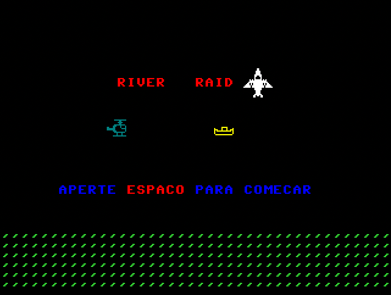
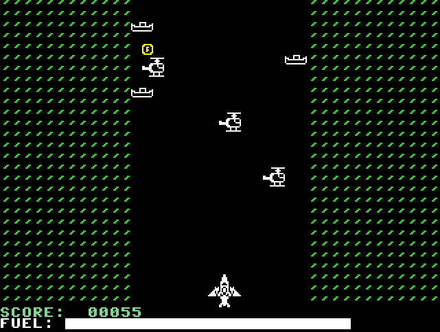
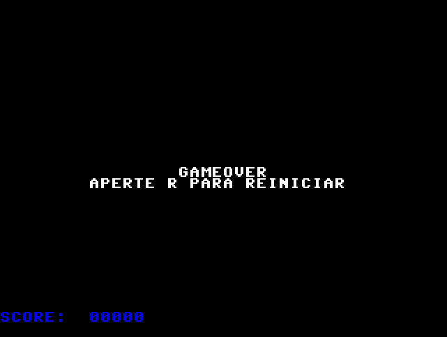

# River Raid Demake

  
  
  

Esse repositório contém uma cópia do jogo River Raid da Activision produzido para Atari 2600. Esse jogo foi desenvolvido totalmente em linguagem montadora para o [Processador do ICMC](https://github.com/simoesusp/Processador-ICMC).

